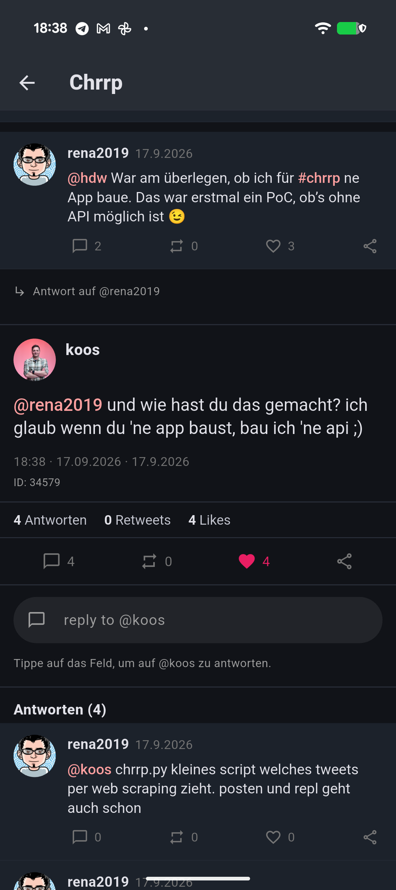
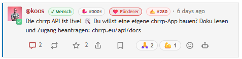

# chrrp

[Chrrp.eu](https://chrrp.eu/) ist ein kleines soziales Netzwerk, das Jan Kus im Frühjahr 2026 ursprünglich als Spaßprojekt ins Leben gerufen hat. Es versteht sich als menschliche, algorithmusfreie Alternative zu großen Plattformen. Beiträge werden chronologisch angezeigt und sind standardmäßig auf 140 Zeichen begrenzt; auf Wunsch sind bis zu 280 Zeichen möglich. Laut Website soll die Plattform KI-generierte Inhalte und Bots eindämmen. Die Teilnahme ist nur mit Einladung möglich, öffentliches Mitlesen hingegen nicht eingeschränkt.

## Die erste App

Im September entstand die erste App für chrrp – anfangs ebenfalls als kleines Spaßprojekt. Zusammengebastelt habe ich sie mit einem Coding-Agent und einer Handvoll kostenloser Tokens für irgendwelche chinesischen LLMs, die damals noch im Beta-Status waren.

Eine API gab es zu dem Zeitpunkt noch nicht. Also blieb nur Web-Scraping: Die Daten mussten direkt von den Webseiten eingesammelt werden. Dass dabei tatsächlich etwas Brauchbares herauskam, hat nicht nur mich überrascht:

## Endlich eine API!

Am 27. Oktober 2026 ging die API an den Start – und damit auch der Startschuss für weitere App-Entwicklung. 

Der Zeitpunkt hätte kaum besser sein können: Das lange Wochenende stand vor der Tür und bot reichlich Gelegenheit, sich an die Arbeit zu machen.

Neben meiner auf die API umgestellten App arbeiten noch zwei weitere Entwickler an eigenen chrrp-Apps: eine für iOS, die andere für Android. Eine davon ist bereits über TestFlight verfügbar, die zweite soll im Laufe der Woche zum Testen bereitstehen. Die Apps tragen die Namen CHRRPINO, CHRRPY und CAPYBIRD.

Meine App ist mit Flutter entwickelt und läuft damit nicht nur auf Android und iOS, sondern auch auf Windows, Linux und macOS. Im App Store wird sie vorerst allerdings nicht zu finden sein, da ich die App nicht über den Account der Firma, für die ich arbeite, veröffentlichen kann. Falls jemand dabei unterstützen möchte, könnten wir die App beispielsweise mit Fastlane auch über die Stores verfügbar machen.

Der Quellcode liegt derzeit noch in einem privaten GitHub-Repository. Mal sehen, ob sich dafür eine Lösung findet!

## Web und App: noch nicht ganz auf einer Wellenlänge

Im Moment gibt es noch ein paar Unterschiede zwischen der Webseite und der App. Diese Funktionen sind bisher nur im Web verfügbar:

- Die öffentliche Timeline
- Direktnachrichten (DMs)
- Das Ritual beziehungsweise die „Frage des Tages“
- Pulse: „Wie ist dein Tag bisher?“

Mal sehen, was sich bei [chrrp](https://chrrp.eu/) noch tut – und welche Funktionen es als Nächstes in die App schaffen.

